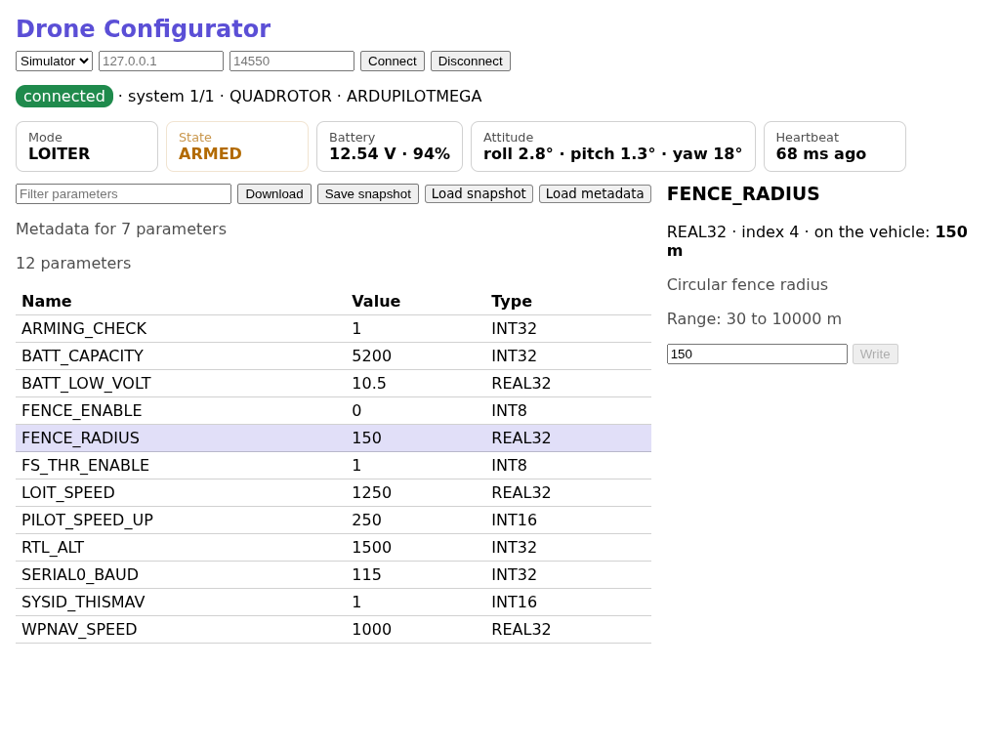

# Drone Configurator

A MAVLink 2 configuration dashboard built with [Pico Desktop](https://github.com/padcom/pico-desktop).
- **Frontend:** Vue 3, TypeScript and Vite (the state is in composables; see `docs/frontend-state.md`). The text of the components goes through vue-i18n (only English exists so far); messages built in the composables and helpers (the backend-restart notice, error lines, the write and apply questions, draft and metadata problems, the settings notices) are still plain English.
- **Backend:** Pico, on [pico-mavlink](https://github.com/padcom/pico-mavlink).

It's the reference application of the Pico Desktop plan (§14). It's independent of the framework and not required for its release.

Status: **an application that connects to a vehicle, shows its telemetry, and reads and writes its parameters.** It has a rail of seven screens, of which three exist (Flight data, with the display, the cards and the messages; Parameters; and Settings, with the language); Plan, Setup, Tune and Logs say they are not available yet. A top bar shows the vehicle and the link, and the mode, state, battery and GPS, on every screen, and the Connect dialog opens from it. The interface has one theme, and it is dark. There is no map and no setup screens yet.
- Connect to the built-in simulator, over UDP or TCP, or over a serial port: USB or UART, from the backend's port list, at the baud rate you choose. See the vehicle and its heartbeat, mode, armed state, battery, attitude, and (when the vehicle sends them) its position, GPS fix and speed.
- Download the parameter list. An incomplete download says which indexes are missing.
- Filter the list, and see a parameter's typed value.
- Edit a value: it's checked against its type, you confirm the write, and the vehicle's read-back is verified. A value the vehicle changed, or a write it never confirmed, is reported as such, never as success.
- Save the parameters as a snapshot, and load one to review what it would change. Nothing is ticked at first, and a change that can't apply says why: not on this vehicle, another type, or out of range. Writing the ticked changes takes one confirmation, verifies each change, stops at the first one that doesn't verify, and keeps a backup of the values from before. In Pico Desktop, files go through the host's native dialogs.
- Load parameter metadata (descriptions, units, ranges, named values, bits) to see and check against. Without it, a parameter is only its type: nothing is invented. Two kinds of file are read by the same button: ArduPilot's own definitions (`apm.pdef.json`, as the ArduPilot site serves it for a vehicle: nothing is bundled or fetched, you load the file) and our own small format (in `apps/frontend/src/lib/params/metadata.ts`; `examples/copter-metadata.json` is an example, with values that are illustrative, not ArduPilot's). The detail of the selected parameter has a Description block with the full text, the range, unit, step, values, bits and whether the vehicle must be restarted.
- Parameters the vehicle announces on its own, for example after another ground station changes one, update the list. A draft being edited is left alone.
- A disconnect cancels a download or write in flight at once.
- Telemetry shows only what the vehicle has reported: a dash, never a made-up zero. Mode names come from ArduPilot's own tables, chosen by vehicle type.
- The backend asks the vehicle for ten messages at fixed rates (position, speed and attitude 4 Hz; GPS, navigation and EKF 2 Hz; battery, wind and vibration 1 Hz; the table is in `apps/backend/groups.pi`), and asks again when the vehicle restarts. A message the vehicle refuses is left out. Each arrives as a group with its own age, in metres, metres a second and degrees; a group the vehicle never sent is absent, and a position of latitude and longitude 0 counts as none. The page gets the latest values 5 times a second (`rateHz`, 1 to 20), whatever rate the vehicle sends at.
- Cards show battery, attitude, position, GPS and speed (navigation, wind, EKF and vibration reach the page but have no card yet). A value not updated for more than 3 seconds says "stale, N s old" and is marked, not just coloured.
- The Flight data screen has three panes: a map and a heads-up display (neither is built yet: they say so) and the details, whose first tab is those cards. Each bar moves with the pointer or the arrow keys (Home and End go to the ends), and a pane can be collapsed to its header with its button and opened again; the layout is kept for the next start. **F6** moves the focus to the next pane and **Shift+F6** to the previous one, from anywhere in the window while the screen is shown (Tab then goes on into the pane).
- The parameter encoding (C-cast or bytewise) comes from the autopilot's AUTOPILOT_VERSION, with ArduPilot's or PX4's usual one as a fallback.
- Closing the app while connected ends the session in time.
- A backend restart ends the vehicle session. The parameters stay on screen, a write that was in flight is reported as unconfirmed (never resent), and you reconnect when you choose.
- A link that drops does not end the session. When the link ends (a TCP connection or a serial port that closes), or the vehicle sends no heartbeat for 5 seconds, the dashboard says "reconnecting" with the try and the wait until the next (1, 2, 4, 8 s, then every 10 s), keeps the vehicle, the parameters and the last telemetry on screen (marked as the last heard), and stops what was running; a write in flight is reported as unconfirmed and never sent again. The backend opens a TCP or serial link again by itself and waits for a heartbeat. If the vehicle that answers is the same one (system, component, type, autopilot and unique id), it says "reconnected to the same vehicle"; if it is another, it says so and treats it as a new connection, downloading its parameters again. Disconnecting, or connecting somewhere else, ends the tries. (Parameters are downloaded in full after a reconnect. ArduPilot has no `_HASH_CHECK` parameter, the fingerprint PX4 offers: SITL does not answer a read of it, and it is not among the 1432 parameters it lists. Reusing a list needs MAVFTP's parameter file (pico-mavlink#11) or resuming a partial download (pico-mavlink#22).)
- The backend keeps settings that survive a restart (`settings.get`, `settings.set`; language, theme, and entries of the interface's own such as layouts) in one file, `settings.json`, in the app's data directory (`~/.local/share/pico-desktop/apps/dev.pico-desktop.drone-configurator` on Linux, or under `XDG_DATA_HOME`). It is plain JSON, laid out for a person to read and edit (a member to a line); deleting it resets the settings, and a member the app does not know is skipped (and gone at the next save). The file holds to the same limits as a change made by the app (a language of 1 to 35 characters, no key twice, a million characters at most). `version` is a whole number, 1 for now; any member added to the document gets a new version, so that a rolled-back app sets the file aside instead of erasing the member. A `settings.cbor` from the first version of this (a single release) is not read and is left where it is. It is written to a temporary file and renamed over the old one, so a cut-short write leaves the old settings whole. A file that cannot be read, is not a settings document, or that a newer version wrote, is renamed aside (`settings.json.corrupt-…`, `.unreadable-…`, `.newer-…`) and the app starts on defaults and says so (a line under the title, which can be dismissed); if the directory cannot be written to, the settings are kept in memory and the app says that. The language will be the first thing chosen from a list once there is a second one; a language an earlier version kept in the browser's storage is moved into the settings once.



## Run it

It expects `pico-desktop`, `pico-lang`, `pico-mavlink` and `pico-serialport` next to this folder (as in `~/projects/padcom/pico`). It also needs a pico with pico-lang PRs #103 and #105, until they're released.

`pico-desktop` has to be built first, once (and again after you update it): its CLI (`pico-desktop dev`, `test`, `build`, which this project's scripts call) and the CEF host are not in the checkout. Without it, `pnpm dev` fails with `ERR_MODULE_NOT_FOUND` for `tooling/cli/dist/index.js`.

```sh
cd ../pico-desktop
pnpm install
pnpm build    # the CLI and the packages; before `pnpm cef`, whose tests use the CLI
pnpm cef      # fetches the pinned CEF, builds the host and stages the runtime (Linux; see pico-desktop's docs/platform-linux.md)
cd ../drone-configurator
```

Then:

```sh
pnpm install
pnpm dev      # the app, with the "Simulator" transport for a vehicle without hardware
pnpm ui       # the frontend alone in a browser, on a TypeScript mock of the backend
pnpm test     # Vitest (the UI's logic and rendering, and a check that the production build satisfies the CSP) and pico test (the backend)
pnpm lint     # pico lint, ESLint with the padcom rules (@padcom/eslint-config-vue) on .vue and .ts, vue-tsc and tsc
pnpm e2e      # the real window: host, Pico backend, pico-mavlink and the simulator (apps/frontend/e2e, pico-desktop test --e2e)
```

The frontend is built on the Vue 3 template (pico-desktop's `vue-ts`). The padcom lint rules apply to every `.vue` and `.ts` file except the ones listed in `apps/frontend/eslint-baseline.txt` (7 files now, written before the rules; a file leaves the list as it is brought up to them, and the list may not grow). `__VUE_OPTIONS_API__` is off in `vite.config.ts`: components use `<script setup>`.

## Bundle and package

```sh
pnpm exec pico-desktop build     # dist/drone-configurator-<version>-linux-arm64/: runs without Node, pnpm or Pico
pnpm exec pico-desktop package   # that bundle as a .tar.gz (+ .sha256), and an AppDir for appimagetool
```

The bundle carries its runtime (CEF), an SBOM and THIRD-PARTY-NOTICES.txt.

## ArduPilot SITL

With an ArduPilot checkout ([building SITL](https://ardupilot.org/dev/docs/setting-up-sitl-on-linux.html)):

```sh
cd ardupilot/ArduCopter
../Tools/autotest/sim_vehicle.py --out=udp:127.0.0.1:14550   # or connect over TCP to 5760
```

Then, in the dashboard, choose UDP on port 14550, or TCP on port 5760, and connect.

The dashboard asks for the ten messages of its table (see Status above) with `MAV_CMD_SET_MESSAGE_INTERVAL`, or with data streams for a vehicle that has only those. It learns how parameters are encoded from `AUTOPILOT_VERSION`.

To run the end-to-end checks, either let the harness start a simulator, or say where one is.

```sh
SITL_BINARY=ardupilot/build/sitl/bin/arducopter pnpm e2e   # the harness launches its own Copter SITL
SITL_ENDPOINT=tcp:127.0.0.1:5760 pnpm e2e                  # or udp:127.0.0.1:14550: one that is already running
```

They detect the vehicle, download the whole parameter list, follow the telemetry, write `BATT_CAPACITY` with a verified read-back and put it back, save a snapshot, apply an edited one and keep a backup, reconnect, and close the app while connected. The same checks run over TCP against the simulator behind a port (`apps/backend/e2e/tcp-vehicle.pi`).

`sitl-reconnect.e2e.ts` starts its own SITL (it ignores `SITL_ENDPOINT`) behind a proxy that can be cut (`apps/frontend/e2e/flaky-proxy.ts`) and pulls the cable during telemetry, during a parameter download and just after a write, then puts another vehicle (a hexacopter) behind the same address.

**Only point `SITL_ENDPOINT` at a simulator.** The suite writes to whatever it connects to. It tries to put the value back even when a check fails, but it can't if the link is lost.

### The harness

`apps/frontend/e2e/sitl.ts` starts a SITL for a test: `startSitl({ vehicle: 'copter', frame: 'quad', speedup: 5, simParams: { SIM_WIND_SPD: 8 } })`, or `withSitl(options, async sitl => { ... })`, which always stops it.

- It finds the executable from `SITL_BINARY`, or `arducopter` on the `PATH`. Build it with `./waf configure --board sitl && ./waf copter`, using the Python that has `empy==3.3.4`. A relative `SITL_BINARY` is fine. Older builds (Copter 4.7) don't carry their default parameters, so the harness passes `default_params/*.parm` with `--defaults`, taken from next to the executable (what CI ships) or from the source tree's `Tools/autotest/default_params` for a build in `build/sitl/bin`.
- Each SITL gets free ports (an ArduPilot instance: TCP 5760 + 10n, and so on), a working directory of its own and a fresh EEPROM, so tests can run side by side. `sitl.endpoint` is where the dashboard connects.
- It waits for a heartbeat. If SITL doesn't come up, the error says why: SITL's exit code and the end of its output. Nothing is left running, and its directory is removed.
- `sitl.setParam('SIM_WIND_SPD', 8)` sets a parameter, usually a `SIM_*` one (wind, a failed sensor), and waits for the vehicle to report it. It uses SERIAL1 (TCP 5762), so SERIAL0 stays free for the app under test.
- `speedup` runs the simulation faster than real time.
- With `SITL_ENDPOINT` set, the harness launches nothing and the suites use that simulator.
- A test file that needs SITL uses `describeSitl` (`sitl-suite.ts`). If there is no SITL it fails when `CI` is set, and is skipped, with the reason, elsewhere. It is never silently skipped in CI.

The harness only ever launches or connects to a simulator.

## Layout

- `packages/contracts/app.cddl`: the contract (methods, subscriptions, types) between the dashboard and the backend.
- `docs/frontend-state.md`: how the interface calls the backend (`src/backend/client.ts`), when subscriptions end, how errors look, and the frame rule for fast data (`src/state/frame.ts`).
- `apps/backend`: the Pico backend. It owns the MAVLink link: discovery, heartbeats, parameter list/read/write with retries and read-back, and telemetry.
- `apps/frontend`:
  - `src/` is laid out as in `apps/frontend/src/README.md`: `components/` (`ui/` the kit, `fields/`, `params/`, `fly/`, `shell/`), `screens/`, `composables/` (the state and the backend calls: `useVehicle.ts`, `useParams.ts`, `useMetadata.ts`, `useSnapshots.ts`, `useTelemetry.ts`; `useConfigurator.ts` puts them together, see `docs/frontend-state.md`), `lib/` (the plain logic of the components), `state/`, `backend/` (`client.ts`), `i18n/` (the text is in `i18n/locales/en.json`), `assets/styles/`, `mock/` and `testing/`;
  - `main.ts`: starts the composables and mounts the application (`components/shell/Shell.vue`);
  - `mock/mock-backend.ts` and `mock/fixtures.ts`: a deterministic simulated vehicle for Vitest and `pnpm ui`.
  - The map of the Flight data screen (`components/map/FlightMap.vue`, `composables/useFlightMap.ts`, `lib/map/`): our own raster engine on a 2D canvas over the backend's tile service (the page never reaches a tile server). The credit of the source ("© OpenStreetMap contributors" for the built-in one) is a link on the map itself, `target="_blank"`; that a click on it opens the system browser in the pico-desktop host (CEF) follows pico-desktop's navigation policy (docs/security-model.md: web links open in the system browser on a user gesture) and has **not been verified** here by a click in the real window. Over the tiles the map draws what a `MapSource` (`lib/map/mapSource.ts`) gives it: the live one (`composables/useLiveMapSource.ts`) is the connected vehicle (an arrow with its heading, hatched with "last heard" when its position is more than 3 s old, none without a position and never at (0, 0)), its path (at most 5000 points, thinned, started again when the vehicle is armed or another connects) and home (the `home` telemetry group, from HOME_POSITION, asked for at 0.2 Hz); a log's replay gives the same three (and its path ahead, dashed), see below. The marker is the vehicle's own estimate of where it is (its GLOBAL_POSITION_INT), and the map shows no GPS quality; the path and the marker stay while the link is down (the marker is hatched and counts the time since the vehicle was heard), and start again only when the vehicle is armed or another one (another system id) connects. The markers carry `data-lat`/`data-lon` and an `aria-label`; the map follows the vehicle until it is dragged, and the two buttons follow it again and centre on it. The e2e apps start with the map's tiles off (`e2e/launch.ts`), so no test asks a real tile server; `e2e/flight-map.e2e.ts` brings a fake one.
  - Replay (Logs, `screens/logs/LogsReplay.vue`, `composables/useReplay.ts`, `lib/logs/replay.ts`, backend `localtrack.pi` and the contract's `logs.local.track`): a flight of the logs on this computer on the same map, with the flown path solid, the path ahead dashed, home and the vehicle moved by the page's own clock (a frame at a time while it plays, a seek or a frame asks the backend for nothing: the track is in memory). The backend reads the log once and gives at most 2000 points (a part of the time keeps its first fix, the last and the one farthest from the first, so a turn is never cut off), the positions of the EKF (`POS`; a recording's GLOBAL_POSITION_INT) or else the GPS's 3D fixes of one receiver, home as the log says it (ORGN type 1 / HOME_POSITION, never the first fix), and the events: armed and disarmed (`EV`) and the vehicle's warnings (a line with failsafe, error, crash or lost in it), each class with its own cap of 300; the page adds the changes of flight mode. A position at 0, 0, outside the globe, or without a 3D fix is never drawn; the backend tells where the LOG has no position for more than 3 s (a gap, both ends of which are always among the points; the distance between two thinned points says nothing of that), and there the vehicle holds the last fix and is marked as old (the speed tile is a dash; elsewhere the speed is the average between the two kept fixes either side); a log with no position says why and draws nothing; an unverified log is not looked into. Tiles come from the cache when offline (the map's chip says what is missing). **Covered** by `backend/localtrack.test.pi` (a generated DataFlash log and a recording), vitest, and `e2e/logs-replay.e2e.ts` over a generated DataFlash log in the real window. **Not covered**: a log written by ArduPilot itself (the SITL flight of `sitl-logs.e2e.ts` flies straight up, so its track would be a point), the recording's `GLOBAL_POSITION_INT` in a window, tiles of a real source. A position the vehicle did not log (no `POS`, GPS without a 3D fix) is not guessed.
  - The scrolling rule (`assets/styles/frame.css`, `setup.css`, `params.css`; checked by `e2e/layout.e2e.ts`): from 1000 px wide only the middle column of a screen scrolls (Parameters, Setup pages, Tune parts); the rail, the top bar, the list of pages or the tabs, the page header and the side panel stay where they are, and the middle column never scrolls sideways (what does not fit beside the list and the side panel is stacked, by a container query). The list and the side panel scroll by themselves only in a window too short for them. Below 1000 px wide everything is stacked, the rail lies on top and the page scrolls as a page does (a page-level scrollbar there is the design).

## Safety

Parameter writes change how a vehicle flies. Test against SITL or the simulator first, and keep a backup of the parameters before writing to real hardware.

**Arming, disarming, flight modes and the pre-arm checks (the backend; the controls are below).** `vehicle.arm`, `vehicle.disarm`, `vehicle.setMode` and `vehicle.prearm` (MAV_CMD_RUN_PREARM_CHECKS) send each command ONCE and never again: an unacknowledged arm may have armed the vehicle, so the answer is `no-answer`, and the state shown is whatever the next heartbeat says, never the command's intent. There is **no forced arm**: the arm always runs ArduPilot's pre-arm checks (a refusal comes back with the vehicle's own "PreArm: ..." texts, together with whatever else the vehicle said meanwhile). The backend refuses before sending, whatever the page believes: no vehicle, a state that is not known (no heartbeat for 3 s), an arm of an armed vehicle, a disarm of a disarmed one, another command or a parameter/log operation/calibration/motor test/reboot under way, a mode that is not one of the vehicle kind's. **An arm in flight makes the armed state unknown for every other service** (so no parameter write, calibration, motor test, log operation or reboot starts while the vehicle may be arming): from the send until 1.5 s after an accepted answer, 5 s after a missing one; a refusal releases it. **`vehicle.emergencyStop` is the exception to all of this** and the only place ArduPilot's force value (a disarm that works in flight: the motors stop and the vehicle falls) is sent: its only refusal is no connection (an unknown state counts as armed, the armed flag lags, and a forced disarm of a disarmed vehicle changes nothing), and it is the only command sent again: up to 3 times, 500 ms apart, until the first ack. An ack is matched by command number and sender only, so a normal disarm and a stop answer each other: **that the vehicle has stopped is read from the heartbeat, never from an ack**. An arm is held off (`BUSY`) while a stop's resends run. A change to RTL or LAND (idempotent, in-flight safety actions) is allowed in an unknown state and while another command is out; every other mode change needs a known state. `telemetry` gains a `prearm` group from SYS_STATUS's PREARM_CHECK bit (`enabled`: the vehicle has an arming check on; `passing`: they pass now): what ArduPilot says, not a promise that an arm succeeds. **What ArduPilot SITL has checked** (`e2e/sitl-arming.e2e.ts`, on the real backend; the app has no buttons in that spec): the pre-arm bit (`enabled`, not `passing`) and the vehicle's PreArm text from `vehicle.prearm`; an arm refused (FAILED); an arm accepted once the position and the EKF are ready, with the heartbeat saying armed, and a disarm on the ground, with the heartbeat saying disarmed; LAND and RTL accepted, the heartbeat naming them; the emergency stop of a vehicle on the ground and of an armed one on the ground; every command refused with `NOT_CONNECTED` when disconnected. **What it has not checked:** a stop, a disarm or a mode change IN FLIGHT (SITL's own flight is only used by the map's spec), a stop whose ack is lost, and the hold that keeps an arm off while a stop's resends run (those are tested with the simulated vehicle only). ArduPilot answers RUN_PREARM_CHECKS ACCEPTED whatever the checks found (TEMPORARILY_REJECTED while armed): the reasons are the texts, and it does not print a PreArm text again at once, so **an arm that was refused can come back with no text at all**: the reasons the page shows are the vehicle's messages of the last two minutes.

**Guided control (the backend; the buttons are the next change).** `vehicle.reposition`, `vehicle.changeAltitude`, `vehicle.setSpeed` and `vehicle.setHomeHere` (pico-mavlink's `VehicleControl`, COMMAND_INT for a place), sent ONCE like the rest, with no force value; the rules are `apps/backend/guided.pi` and they come from the ArduPilot source (quoted in pico-mavlink's `arming.pi`). The backend refuses before it sends: not connected, state unknown, not armed (`NOT_ARMED`), not in GUIDED (`NOT_GUIDED`: a reposition never changes the mode), busy, a number that is not one (NaN, infinity, a place off the globe or at 0, 0, which a vehicle takes for "here": `INVALID_VALUE`), beyond the request's limits (`OUT_OF_LIMITS`; the page sends 50 m / 500 m from home / 10 m/s unless Settings say otherwise; the backend holds them to its hard 120 m / 5000 m / 30 m/s and 2 m minimum), a vehicle on the ground (`NOT_AIRBORNE`), and no home (`HOME_UNKNOWN`: HOME_POSITION comes at 0.2 Hz, so a home older than 15 s, three periods, is unknown, and so is one that a set of home here has just moved, until the vehicle says the new one). **The vehicle's own fence is the backend's too**: it reads FENCE_ENABLE (and, when it is on, FENCE_TYPE, then FENCE_ALT_MAX, FENCE_ALT_MIN and FENCE_RADIUS for the bits that are set) at each reposition and change of altitude; an altitude above FENCE_ALT_MAX or below FENCE_ALT_MIN, or a place beyond FENCE_RADIUS from home, is `OUT_OF_LIMITS`, and a fence that cannot be read is `FENCE_UNKNOWN` (nothing is assumed good, as for Take off). **A change of altitude is a reposition to where the vehicle is** (a Copter has no change-altitude command), so it needs the BACKEND's own position at most 1 s old (`STALE_POSITION`) and a vehicle that moves at most 3 m/s over the ground (`VEHICLE_MOVING`: wait until it has stopped, or send Go here again), and **it cancels a reposition under way and holds the vehicle at that place**. The failsafe: the backend reads FS_GCS_ENABLE itself, and when it is 0 or cannot be read the request's policy decides: `block` (the default, `GCS_FAILSAFE_OFF`) refuses, `warn` sends it and says so in the answer's messages. **Set home here** (DO_SET_HOME with param1 1: the vehicle's own place; a place on the map is not offered, because the altitude of home is above sea level and the page does not know the ground) needs a fresh position and a vehicle that stands still: at most 1 m/s over the ground and 0.5 m/s up or down (`NOT_HOVERING`: home's altitude moves with home, not in the middle of a climb); it moves home's altitude as well, so every height above home changes its reference, and RTL goes there. **Covered**: `guided.test.pi` (the rules, the fence, and the commands against the simulated vehicle), `e2e/guided.e2e.ts` (the real window with a scripted vehicle that notes every command: what is refused sends it NOTHING; a reposition is one COMMAND_INT; a set of home forgets home until it is said again) and `e2e/sitl-guided.e2e.ts` against ArduPilot SITL through the backend (refusals, a reposition north with the failsafe warning whose result is the vehicle's own position, a change of altitude, a speed, set home here, land). **Not covered**: a polygon fence (it is not read: only the maximum and minimum altitude, above home, and the circle are; an altitude fence in another frame, FENCE_ALT_MAX_TP or FENCE_ALT_MIN_TP not 1, blocks as `FENCE_UNKNOWN`, and so does a frame that cannot be read, unless the connection's complete parameter list shows that the vehicle has no such parameter (4.7.2 has none), which means above home; the names are forgotten when a reconnect takes a vehicle up again, another one or the same one with a new firmware, so the page downloads the complete list again before it offers guided control; and FENCE_ALT_MIN is negative as a rule: -10 by default), a link that drops in flight, and the buttons (the next change).

**Go here (the map's guided control; the backend is the paragraph above, change altitude and set home here are the next change).** A click on the map (a press and a release in the same place: a drag moves the map) picks a place: a ring on the map and a card at its bottom RIGHT (the notices come up at the bottom left, and the credit of the map stays visible) with the coordinates, Go here and Clear. The place is picked for one vehicle and one link: it is dropped when the link is lost, the vehicle goes or another answers in its place. Go here is the command `vehicle.goHere` (in the palette too), offered to a connected, armed vehicle whose state is known, **in the air**, that reports its position and home, with the **complete list of its parameters downloaded** (the backend reads the fence only by it; the page downloads the list again whenever a link comes back, the same vehicle or another, so the gate is never a memory of the vehicle before), and a place within the distance from home the user allows. It is refused (with the reason on the card, before the click) for a vehicle that is returning home or landing (RTL, SMART_RTL, LAND: the user changes the mode on purpose) and for one that is above the user's highest altitude (Go here keeps the altitude: it would send it down). In every other mode but GUIDED the card says before the click that Go here will switch the vehicle to GUIDED. **Settings, Guided control**: how it is confirmed (none, a plain confirmation that says, once, how far, how high and how fast, which is the DEFAULT, or a hold; the card says how far only when no confirmation does), what to do when the vehicle's GCS failsafe is off (block, the DEFAULT, or warn and send), the highest altitude (50 m), the farthest from home (500 m), the greatest speed (10 m/s) and the speed of a Go here (5 m/s, never above the greatest); the backend holds the numbers to its hard ones. **What was confirmed is what is sent**: the place, the altitude, the speed, the limits and the failsafe policy are taken ONCE, when the command starts, and exactly those are sent whatever is picked or changes while the steps wait; the page's gates are looked at again after the wait for GUIDED. Then, each step only if the one before it came out and nothing sent again: GUIDED (waiting for the heartbeat), the speed of the guided mode, ONE reposition. **The speed STAYS set when the reposition is then refused** (it is not put back: the vehicle keeps the guided speed; the card says so). What the backend refuses is told in words and the place is kept; an accepted reposition drops the place (if it is still the one that was sent: a place picked meanwhile stays picked and is not sent). **Covered**: vitest (the rules, the command and its flow with a place picked during the wait, the settings, the card, the map's click, the re-download after a take-up) and `e2e/go-here.e2e.ts` (the real window with a scripted vehicle that notes every command: a click picks, the credit stays visible, the failsafe off sends nothing, Cancel sends nothing, a confirmed Go here is one reposition to the place). **Not covered**: a drop of the link while the vehicle flies, the arrival (the vehicle's position says it), and real ArduPilot for the page's flow (the backend's own SITL spec, `e2e/sitl-guided.e2e.ts`, covers the commands).

**Change altitude and Set home here (the map's other two guided commands; `vehicle.changeAltitude` and `vehicle.setHomeHere`, a button each beside the map and in the palette).** **Change altitude** opens a dialog that proposes the altitude the vehicle is at and takes one from 2 m to the user's highest; its button is a PLAIN one (it ignores presses for its first 400 ms, like every question), and the dialog says that the vehicle holds where it is and that what it was flying to is cancelled, and that it changes to GUIDED first when it is in another mode. It is offered to an armed vehicle in the air with a position and the complete parameter list that is near a stop (at most 3 m/s over the ground: it is a reposition to where the vehicle is) and is not coming home or landing. The altitude, the limits and the failsafe policy are taken once; after the wait for GUIDED the gates are looked at again, and a stop then says that the vehicle was put in GUIDED and stays there (the same is said by Go here). **Set home here** asks a HOLD that says that Return home (RTL) flies to the point from now on and that the altitude of home moves with it (every altitude above home changes its reference); it is offered to a vehicle whose state is known (armed or not) with a fresh position that stands still (at most 1 m/s over the ground and 0.5 m/s up or down), and after an accepted answer it says again that Return home now flies there. Only "here" is offered: the altitude of home is above sea level and the page does not know the ground. Nothing is sent again, and what the backend refuses (`VEHICLE_MOVING`, `NOT_HOVERING`, the limits, the fence, the failsafe ...) is told in words. A change of altitude takes the limits and the failsafe policy once at its start, like Go here (the choice made while it waits for GUIDED is not the one sent). Go here also ends its question about a place that is turned down, and says "the picked place changed: check it and go again" when the place changed between the question and the answer. **Covered**: vitest (the rules, both commands and their flows, the dialog) and `e2e/guided-actions.e2e.ts` (the real window with a scripted vehicle that notes every command: the dialog, ONE change of altitude to the place the backend heard, a hold that turned down sends nothing, one DO_SET_HOME) and `e2e/guided-refusals.e2e.ts` (the scripted vehicle now says its velocity and can lack parameters: a vehicle that moves, or only climbs, has the buttons off with their words and sends nothing; an altitude above the vehicle's fence (FENCE_ALT_MAX 25, 30 asked) is refused in words with no reposition; a list that stays incomplete after a new link keeps Change altitude off). The card of Go here is one rem higher below 1000 px, so that its buttons stay in a window of 999 x 700 (checked at 1440 x 900, 1000 x 700 and 999 x 700). **Not covered**: real ArduPilot for the page's flow (the backend's `e2e/sitl-guided.e2e.ts` covers the commands) and a link that drops in flight.

**The controls of a flight.** Arming and the flight mode are the TOP BAR's two cells, one place for each: **STATE** of a disarmed vehicle is the arm control (its words are the state's), and **MODE** opens the list of modes. A click on STATE goes to the review when the vehicle says its checks do not pass or does not say (it asks the vehicle to run its checks and lists what it said in the last two minutes, in its own words: ArduPilot does not repeat a text it just printed, so an arm's own answer may carry none, and a refused arm's notice borrows these), else straight to "Arm the vehicle". That dialog has **Hold to arm** as the button with the focus (the first 400 ms are ignored, a key repeat does nothing, letting go early cancels), **no Cancel button**: a cross in the corner and Escape turn it down. There is no forced arm. STATE of an armed vehicle is only words. **The mode is chosen from a MENU, never from a list that changes its value as keys move over it** (a native list in Chromium changes on every ArrowDown): keys that move over it send nothing, a mode is asked for only by choosing its item, the mode the vehicle is in cannot be chosen again, and the list scrolls when the window is shorter than it. A change of an armed vehicle's mode asks a plain confirmation naming the mode, **unless Settings > Flight controls say it asks nothing** (the safe default is to ask); RTL, Land, Loiter and Brake never ask (delay is the hazard), and a disarmed vehicle is never asked. When the state is not known only RTL and Land are offered (the backend's rule). The strip above the map (a notice comes up at the bottom left of the window and must never cover it) shows what the vehicle says of its pre-arm checks (its SYS_STATUS bit), and, for an armed vehicle, one whose state is not known (it counts as armed) and one that has just been asked to arm and said yes (its heartbeat is a moment late: the state is not known for 3 s), "Disarm" (a hold) and, under "More", the **emergency stop** (a red hold, there and nowhere else: not in the palette, no key): the motors stop where the vehicle is and it falls. Whether Disarm and the stop move to the STATE cell while armed is the leader's to say (this keeps them in the strip, always reachable). The palette has the same commands (Arm, Disarm, Review before arming, a flight mode each: all dangerous, so never boosted by use), each disabled with its reason when it may not run; the backend checks everything again. **Take off** (`vehicle.takeoff`, MAV_CMD_NAV_TAKEOFF, ArduPilot only, sent ONCE like the rest; the backend refuses `NOT_ARMED`, `BUSY`, `STATE_UNKNOWN`, `NOT_CONNECTED`, `UNSUPPORTED_VEHICLE` and an altitude outside 2 to 120 m): the palette command opens a dialog with the altitude (2 m to the setting "Highest takeoff", 50 m by default, never above the vehicle's own fence) and a plain confirm button, not a hold; the command is enabled only with a 3D fix, the EKF's position and the vehicle on the ground. The button puts a vehicle that is not in GUIDED in GUIDED (waiting for the heartbeat), arms a disarmed one with the arm's own review and hold, waits for the heartbeat to say armed, and sends the takeoff at once (ArduPilot disarms an idle armed vehicle). Each step stops the flow at the first that does not go. **Covered**: `arming.test.pi`, pico-mavlink's simulator, vitest, `e2e/takeoff.e2e.ts` (the real window with a scripted vehicle: the row is off without a fix and on with one; the dialog's altitude checks, Cancel and Escape, the first 400 ms; a turned-down arm hold ends the flow even when someone else arms the vehicle; a held arm is followed by one takeoff to the typed altitude) and `e2e/sitl-arming.e2e.ts` against ArduPilot SITL (refused disarmed and out of limits; accepted in GUIDED, the altitude reaches about 5 m, land and disarm; refused by the vehicle in STABILIZE). **Not checked**: the fence in a window (unit tests only), a real vehicle.

**The Setup pages never write to a vehicle that is armed, or may be.** The Tune screen is the one exception (the leader's decision Q7: tuning is done in flight). Its writes are allowed while the vehicle is armed, with an "Armed: changes apply in flight" banner and a HOLD (not the single question), for the parameters of a fixed list only, within the limits ArduPilot's own table gives them (a negative value, or one above the table's most, is refused; so is one below the table's least while the vehicle is armed, and disarmed that is only warned about), and never when the vehicle's armed state is not known (no heartbeat for 3 s counts as armed). The backend enforces the list and the limits (`apps/backend/tuning.pi`; a name that is not on it is refused armed or not) and looks at the armed state again at the moment of each write. Several parameters are written one after the other, each read back, and a write that stops says which were read back, which were not confirmed and which were not written; nothing is tried again by itself. Nothing on the screen is drawn from the values of the sliders: there is no preview of what the vehicle will do. What the Rate part draws is the vehicle's own: while the screen is shown the app asks it for ATTITUDE and ATTITUDE_TARGET at 25 Hz (borrowed from the rate manager, and given back when the screen is left or the link goes, so the vehicle's message rates are what they were), and draws the actual and the desired roll rate as they come, with the overshoot, the 10 to 90 % rise and the 5 % settling measured of the latest step of the desired rate in the last 10 seconds (a dash, and "No step in the last 10 seconds", when there is none). Without data it says "No data: fly or connect", old data is marked, and the points the backend had to drop are counted and shown. **The chart and its numbers were checked against a SCRIPTED SIMULATED vehicle only (pico-mavlink's `rateScript`), not against ArduPilot or a real vehicle:** what ArduPilot's ATTITUDE_TARGET body rates mean (their frame and scale), the rate ArduPilot really gives at 25 Hz, and what a real stick step looks like in the two lines were not seen, in flight or in SITL (our harness has no stick input). The overshoot, rise and settling are measured correctly of the points that arrive, but they are not validated as the controller's own step response: treat them as a guide, and do not tune by them alone.

**Tune: Filters writes the gyro filter and the first harmonic notch, and is the ONE place where the notch is written while the vehicle is armed.** `INS_GYRO_FILTER` and the notch's `INS_HNTCH_FREQ`, `_BW` and `_ATT` take effect in flight (ArduPilot rebuilds the filter when they change), so they are written like the rest of Tune: after the hold, with the banner, never when the armed state is not known, and a value below the least of ArduPilot's `@Range` is refused while armed (disarmed it is only warned about; the gyro filter's armed least is 10 Hz, not the `@Range`'s 0, which ArduPilot calls "no filtering (not recommended!)": 1 to 10 Hz leaves a vehicle that cannot be flown). `INS_HNTCH_ENABLE`, `_MODE`, `_REF`, `_HMNCS` and `_OPTS` are read only when the vehicle starts: they are written while it is **disarmed** and take effect after a restart; while armed their controls are off and the backend refuses the write (`NEEDS_REBOOT`, "needs a reboot to take effect"), nothing is sent. `_REF`, `_HMNCS` and `_OPTS` are marked `@RebootRequired` in ArduPilot's source; `_ENABLE` and `_MODE` are not, **the app decided those two from the start-up code** (`AP_InertialSensor::init` builds the notch only when it is enabled and sets up its tracking sources by mode), not from a flag, and it is conservative about them. The names, ranges and these flags come from ArduPilot **master (4.8.0-dev)**; the 4.7.2 source was not read, so a firmware that differs (for example, one that reads `_MODE` live) is treated as the table says. The Spectrum tab's notch suggestions are unchanged: they stay in the list of changes and are refused while the vehicle is armed. When a log's spectrum is open in Spectrum and the notch is FIXED (tracking mode Fixed, or reference 0) and has none of its peaks (or their harmonics) inside any of its bands, the page warns that the centre is outside where the noise was logged; a notch that tracks the throttle, an RPM sensor or the FFT moves its centre, so the page says it does not check that. The backend refuses an UNFLAGGED write of the notch's parameters while armed no more than before: that guard ("logging and notch settings are not written while armed") is the frontend's, for the Parameters screen and Spectrum's suggestions.

**Tune: Analyse measures a flight log on this computer; it writes nothing to the vehicle.** The newest dataflash log of the library is preselected ("the last flight"; a recording, `.tlog`, has no RATE messages and is not offered); Analyse reads it and looks at the desired and the actual rate of an axis (Roll, Pitch or Yaw; fields `RDes`/`R`, `PDes`/`P`, `YDes`/`Y` of the RATE message) in two passes of `logs.local.series`: a coarse one over the whole log finds where the desired rate jumps, and a window of about 5 seconds at each of the largest places (at most six, two seconds apart) is measured with the same code as the live response (`lib/tune/stepResponse.ts`). The steps are listed, the largest first and at most eight, with their overshoot, rise and settling; the largest is drawn and any other can be chosen. A log with no RATE messages says so and names the bits of `LOG_BITMASK` that make ArduCopter log them (`ATTITUDE_FAST`, bit 0, or `ATTITUDE_MED`, bit 1); a log with no step that holds says "No suitable step in this log"; a log from another kind of vehicle than the connected one is labelled so. **Not verified:** the passes were run through the real backend over DataFlash files that the tests write (a known step with a first-order lag, a flat rate, no RATE; `apps/backend/localanalyse.test.pi` and `e2e/analyse.e2e.ts`), not over a log that ArduPilot wrote (no flight with a real stick step was seen), and a log whose RATE is logged slowly (below 20 messages a second; the page says so) shows a rough rise and settling.

**The motor test (Setup > Motors) is not verified on hardware.** It was tested against the simulator and ArduPilot SITL only. It spins one motor while a button is held, at 20 % throttle at most, with the propellers OFF (the page asks you to say so); it is refused for a vehicle that is armed or whose armed state is not known, and it stops when the button is let go, the pointer or the focus leaves, the page is left, the link or the session ends, or the page stops saying it holds the button. The vehicle itself is only ever asked for a test of 1.5 s, sent again every 0.8 s, so a vehicle that stops hearing from the app stops the motor by itself within 1.5 s: that is what is relied on when nothing else can reach it (the app killed, the cable pulled). When the session or the window ends the app sends a stop and keeps the link open for 0.3 s so that it can leave (tested against the simulator); whether it arrives over a real serial or radio link was not verified, and if it does not, the 1.5 s above is what stops the motor. A motor is named by its place in the vehicle's test order (A, B, C ...), not by an output: check on the bench which motor turns before you trust a letter.

**The map's tiles are fetched by the backend from a tile server, and that tells the server where you are looking.** `map.tile` asks OpenStreetMap's standard tile server (or an address of your own: https anywhere, plain http only to this computer, no user name or password in it) for the tiles of the area on the screen. The server learns that area, your IP address and the User-Agent `DroneConfigurator/<version> (+https://github.com/padcom/drone-configurator)`; nothing else is sent (no vehicle position, no name). **Settings > Map** has the switch (on by default), offline mode (only kept tiles), the source, the cache size and "Clear the cache"; the backend reads those settings itself at each request, so they hold whatever the page does, and a settings file that cannot be read gives the defaults and says so once. It is polite to the server: at most 2 requests at a time and 150 ms apart, a tile is kept 7 to 30 days (a stale one is asked for again with its etag), a 429, a server error or a silence makes it leave the server alone for 30 s, doubling up to 5 minutes (said once in `map.status`). Tiles are kept as you browse; no area is downloaded in bulk, which OpenStreetMap's policy does not allow. Tiles are kept in the app's cache folder, whose full path **Settings > Map** shows next to the cache size: on Linux `$XDG_CACHE_HOME/pico-desktop/apps/dev.pico-desktop.drone-configurator/backend/tiles` (`~/.cache/...` when `XDG_CACHE_HOME` is not set), on Windows `%LOCALAPPDATA%\pico-desktop\apps\dev.pico-desktop.drone-configurator\backend\tiles` (from pico-desktop's `appDirs` documentation; macOS and Windows not checked here) (`tiles/<source>/<z>/<x>/<y>.tile`, the folder of a custom source is a hash of its address, and a tile's path is made only from integers that were checked), capped at the size you choose, 500 MB by default, the ones used longest ago go first. Clearing the cache removes only that folder's files and removes a link, never follows one out of it. **Limits of the Pico runtime this rests on (pico-lang #136, #137, #138):** `fetch` has no timeout and no abort, so each request has its own timer and a request that is given up still holds its place with the server until the server ends it; `fetch` reads a whole body before it answers, so a tile over 512 KiB is dropped only after it was read (a 4 MiB body took 3.5 s and about 11 MB of memory to drop in the tests, a 16 MiB one outran the 10 s limit); every tile is a new connection (no keep-alive); and **on macOS the system roots are read from the files of the system's certificate bundle, not from the Keychain**, so a root that is only in your Keychain (a company's, for example) is not trusted and the tiles fail with a certificate error: use a custom address of a server whose certificate the bundle trusts. A redirect is never followed (it would go round the rules for an address): it is an error and makes the backend leave the server alone for a while, and so does a 403, which is what a server that blocked this client says. An error text names the host and the kind of failure only, never the runtime's own text, because an address can hold a key. **The credit is a hard requirement of the map engine (M2):** OpenStreetMap's tiles may not be shown without "© OpenStreetMap contributors", linked to its copyright page, on the map itself; Settings shows it too, but that is not enough. **Not verified:** a tile from the real OpenStreetMap server was fetched once by hand (the spike of M0), and never in any test; no test or window e2e contacts a real tile server.

**Logs > Spectrum tells which raw IMU data is before the vehicle's filters and which is after them, only when the log itself says so.** The backend reads the log's own `INS_LOG_BAT_OPT` (its PARM message) and ArduPilot's rule for it (`BatchSampler.cpp`, `AP_InertialSensor_Logging.cpp` `Write_ISBH`): with neither bit 1 nor bit 2 every batch is before the filter; with bit 1 alone every batch is after it; with bit 2 (before and after) the instances of a sensor pair up and the upper half, logged at the IMU's instance plus the number of IMUs, is after it. Any other combination (bits 1 and 0 together, bits 1 and 2), a log with no PARM of the option or with two values of it, and instances that do not pair up are NOT KNOWN (`postFilter` absent in `logs.local.batches`): nothing is guessed. The sources are labelled "before the filters" or "after the filters" only when known. For a source before the filters the page draws the spectrum of the same IMU after them beside it, taken from the source after the filters that the log holds; where there is none it says why (the log does not say, it holds only data before the filters and how to log both, or the IMU's other half was not logged). **No curve is ever made from a model of the filters.** Verified over logs the tests write (`apps/backend/localspectrum.test.pi`), not over a log that ArduPilot wrote with `INS_LOG_BAT_OPT` set: the rule is read from the source, not seen in a flight.

## License

MIT
