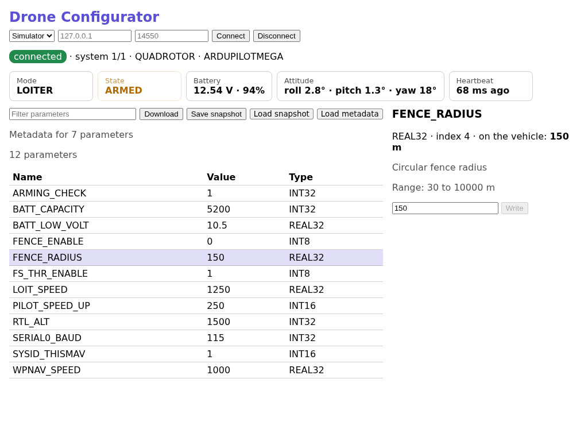

# Drone Configurator

A MAVLink 2 configuration dashboard built with [Pico Desktop](https://github.com/padcom/pico-desktop).
- **Frontend:** vanilla TypeScript and Vite.
- **Backend:** Pico, on [pico-mavlink](https://github.com/padcom/pico-mavlink).

It's the reference application of the Pico Desktop plan (§14). It's independent of the framework and not required for its release.

Status: **DR0 is done; DR1 and DR2 are done except what needs ArduPilot SITL or real hardware.**
- Connect to the built-in simulator, over UDP or TCP, or over a serial port: USB or UART, from the backend's port list, at the baud rate you choose. See the vehicle and its heartbeat, mode, armed state, battery and attitude.
- Download the parameter list. An incomplete download says which indexes are missing.
- Filter the list, and see a parameter's typed value.
- Edit a value: it's checked against its type, you confirm the write, and the vehicle's read-back is verified. A value the vehicle changed, or a write it never confirmed, is reported as such, never as success.
- Save the parameters as a snapshot, and load one to review what it would change. Nothing is ticked at first, and a change that can't apply says why: not on this vehicle, another type, or out of range. Writing the ticked changes takes one confirmation, verifies each change, stops at the first one that doesn't verify, and keeps a backup of the values from before. In Pico Desktop, files go through the host's native dialogs.
- Load parameter metadata (descriptions, units, ranges, named values) to see and check against. Without it, a parameter is only its type: nothing is invented. The format is in `apps/frontend/src/metadata.ts`, and `examples/copter-metadata.json` is an example. These values are illustrative, not ArduPilot's.
- Parameters the vehicle announces on its own, for example after another ground station changes one, update the list. A draft being edited is left alone.
- A disconnect cancels a download or write in flight at once.
- Telemetry shows only what the vehicle has reported: a dash, never a made-up zero. Mode names come from ArduPilot's own tables, chosen by vehicle type. The backend asks the vehicle to stream SYS_STATUS and ATTITUDE.
- The parameter encoding (C-cast or bytewise) comes from the autopilot's AUTOPILOT_VERSION, with ArduPilot's or PX4's usual one as a fallback.
- Closing the app while connected ends the session in time.
- A backend restart ends the vehicle session. The parameters stay on screen, a write that was in flight is reported as unconfirmed (never resent), and you reconnect when you choose.



## Run it

It expects `pico-desktop`, `pico-lang`, `pico-mavlink` and `pico-serialport` next to this folder (as in `~/projects/padcom/pico`). It also needs a pico with pico-lang PRs #103 and #105, until they're released.

```sh
pnpm install
pnpm dev      # the app, with the "Simulator" transport for a vehicle without hardware
pnpm ui       # the frontend alone in a browser, on a TypeScript mock of the backend
pnpm test     # Vitest (the UI's logic and rendering, and a check that the production build satisfies the CSP) and pico test (the backend)
pnpm lint     # pico lint, ESLint with the padcom rules (@padcom/eslint-config-vue) on .vue and .ts, vue-tsc and tsc
pnpm e2e      # the real window: host, Pico backend, pico-mavlink and the simulator (apps/frontend/e2e, pico-desktop test --e2e)
```

The frontend is built on the Vue 3 template (pico-desktop's `vue-ts`): the Vue toolchain is in place, and the code is still plain TypeScript until the components arrive (#11). The padcom lint rules apply to every new `.vue` and `.ts` file. The files that were written before them are on the `NOT_YET_LINTED` list in `apps/frontend/eslint.config.mjs` and leave it as they are brought up to the rules. `__VUE_OPTIONS_API__` is off in `vite.config.ts`: components use `<script setup>`.

## Bundle and package

```sh
pnpm exec pico-desktop build     # dist/drone-configurator-<version>-linux-arm64/: runs without Node, pnpm or Pico
pnpm exec pico-desktop package   # that bundle as a .tar.gz (+ .sha256), and an AppDir for appimagetool
```

The bundle carries its runtime (CEF), an SBOM and THIRD-PARTY-NOTICES.txt.

## ArduPilot SITL

With an ArduPilot checkout ([building SITL](https://ardupilot.org/dev/docs/setting-up-sitl-on-linux.html)):

```sh
cd ardupilot/ArduCopter
../Tools/autotest/sim_vehicle.py --out=udp:127.0.0.1:14550   # or connect over TCP to 5760
```

Then, in the dashboard, choose UDP on port 14550, or TCP on port 5760, and connect.

The dashboard asks for SYS_STATUS and ATTITUDE (`MAV_CMD_SET_MESSAGE_INTERVAL`). It learns how parameters are encoded from `AUTOPILOT_VERSION`.

To run the end-to-end checks, either let the harness start a simulator, or say where one is.

```sh
SITL_BINARY=ardupilot/build/sitl/bin/arducopter pnpm e2e   # the harness launches its own Copter SITL
SITL_ENDPOINT=tcp:127.0.0.1:5760 pnpm e2e                  # or udp:127.0.0.1:14550: one that is already running
```

They detect the vehicle, download the whole parameter list, follow the telemetry, write `BATT_CAPACITY` with a verified read-back and put it back, save a snapshot, apply an edited one and keep a backup, reconnect, and close the app while connected. The same checks run over TCP against the simulator behind a port (`apps/backend/e2e/tcp-vehicle.pi`).

**Only point `SITL_ENDPOINT` at a simulator.** The suite writes to whatever it connects to. It tries to put the value back even when a check fails, but it can't if the link is lost.

### The harness

`apps/frontend/e2e/sitl.ts` starts a SITL for a test: `startSitl({ vehicle: 'copter', frame: 'quad', speedup: 5, simParams: { SIM_WIND_SPD: 8 } })`, or `withSitl(options, async sitl => { ... })`, which always stops it.

- It finds the executable from `SITL_BINARY`, or `arducopter` on the `PATH`. Build it with `./waf configure --board sitl && ./waf copter`, using the Python that has `empy==3.3.4`. A relative `SITL_BINARY` is fine. Older builds (Copter 4.7) don't carry their default parameters, so the harness passes `default_params/*.parm` with `--defaults`, taken from next to the executable (what CI ships) or from the source tree's `Tools/autotest/default_params` for a build in `build/sitl/bin`.
- Each SITL gets free ports (an ArduPilot instance: TCP 5760 + 10n, and so on), a working directory of its own and a fresh EEPROM, so tests can run side by side. `sitl.endpoint` is where the dashboard connects.
- It waits for a heartbeat. If SITL doesn't come up, the error says why: SITL's exit code and the end of its output. Nothing is left running, and its directory is removed.
- `sitl.setParam('SIM_WIND_SPD', 8)` sets a parameter, usually a `SIM_*` one (wind, a failed sensor), and waits for the vehicle to report it. It uses SERIAL1 (TCP 5762), so SERIAL0 stays free for the app under test.
- `speedup` runs the simulation faster than real time.
- With `SITL_ENDPOINT` set, the harness launches nothing and the suites use that simulator.
- A test file that needs SITL uses `describeSitl` (`sitl-suite.ts`). If there is no SITL it fails when `CI` is set, and is skipped, with the reason, elsewhere. It is never silently skipped in CI.

The harness only ever launches or connects to a simulator.

## Layout

- `packages/contracts/app.cddl`: the contract (methods, subscriptions, types) between the dashboard and the backend.
- `apps/backend`: the Pico backend. It owns the MAVLink link: discovery, heartbeats, parameter list/read/write with retries and read-back, and telemetry.
- `apps/frontend`:
  - `configurator.ts`: the state and actions, without the DOM;
  - the Vue components (`ConnectionBar.vue`, `TelemetryCards.vue`, `ParamTable.vue`, `ParamFilter.vue`, `ParamEditor.vue`, `MetadataStatus.vue`, `SnapshotToolbar.vue`, `SnapshotImport.vue`, `ConfirmDialog.vue`), each with a plain `.ts` module for its logic, and `useConfigurator.ts`, which gives them the state as refs;
  - `main.ts`: creates the Configurator and mounts each component into its element of `index.html` (`mountIsland.ts`); their text is in `locales/en.json` (`i18n.ts`);
  - `mock-backend.ts` and `fixtures.ts`: a deterministic simulated vehicle for Vitest and `pnpm ui`.

## Safety

Parameter writes change how a vehicle flies. Test against SITL or the simulator first, and keep a backup of the parameters before writing to real hardware.

## License

MIT
